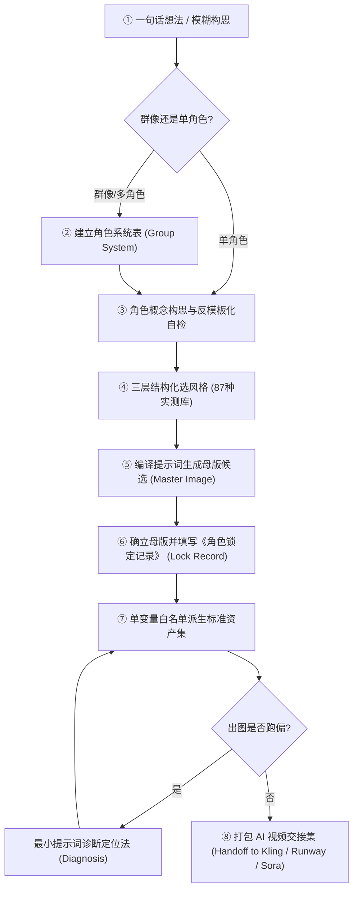

# 🎨 AI 原创角色创作工作室（Character Creation Studio）

> **把「一句话想法」变成有辨识度、可锁定一致性、可直接交接给 AI 视频的原创工业级角色资产包。**  
> 一套专为 **Antigravity / Claude / Cursor 等 AI Coding & Prompting Agents** 打造的标准化角色设计全流程技能体系（Skill）。

[](LICENSE)
[](SKILL.md)
[](#-八步工业级角色生产管线)
[](references/style-library.md)

---

## 📌 项目全景与核心价值 (Executive Overview)

在现有的 Midjourney、GPT Image（DALL-E 3）、Grok Imagine 等 AI 图像与视频创作流中，创作者普遍面临**三大致命痛点**：

| 行业核心痛点 | 传统玄学抽卡做法 | 本工作室工业化解决方案 |
| :--- | :--- | :--- |
| **1. 角色一致性崩溃** | 疯狂重抽提示词，角度一换就崩脸、换身衣服变了个人 | **锁定记录机制（Lock Record）**：确立母版后锁死特征参数，单变量白名单派生 |
| **2. 审美严重模板化** | 充斥千篇一律的锥子脸、大眼睛、廉价磨皮网红质感 | **反模板化自检清单**：强制打碎常见审美套路，赋予独特生物/机械特征与道具 |
| **3. 与视频工具严重脱节** | 只有单张图，视频模型无法抓取面部骨骼与三维转面 | **标准视频交接包（Handoff Pack）**：母版 + 三视图 + 纯净头部图 + 表情板 + 细节板 |

---

## ⚖️ 两条核心工业底线 (Core Philosophy)

> [!IMPORTANT]
> 1. **一致性是流程，不是咒语。**  
>    没有任何现存模型能单靠 Prompt 保证 100% 绝对一致；必须依靠「先锁定母版 → 建立特征参数表 → 每次只改动一个白名单字段 → 看图对照验收」的严格工程闭环取得稳定。
> 2. **稳定胜过惊艳。**  
>    一张略带瑕疵但绝对不漂移的脸，远好过十张每张都美若天仙但完全不像同一个人的脸。

---

## 🔄 八步工业级角色生产管线 (The 8-Step Production Pipeline)



### 步骤详解：

1. **一句话想法**：输入基础设定，如「生活在茶山上的采茶机器人」或「蒸汽朋克多首影子生物」；
2. **角色系统表（群像必做）**：多角色时先定阵营、阶层、色彩互补矩阵，防止群像角色撞脸；
3. **反模板化自检（Anti-cliché Checklist）**：
   * 避开 AI 默认的对称光影、油腻皮肤、标准美女帅哥脸；
   * 注入“功能性缺陷”或“生活痕迹”（如磨损的工具带、异色瞳、缝合线）；
4. **三层结构化选风格**：
   * 走 **「媒介（水墨/版画/3D） → 写实度（扁平/半厚涂/超写实） → 具体风格描述」** 三层漏斗，严禁堆砌无意义的垃圾画质词（如 "8k, masterpiece, highly detailed"）；
5. **母版生成与确立**：生成 2~4 张首轮候选，仅在这个关键节点需要创作者拍板定版；
6. **建立锁定记录（Lock Record）**：
   * 将母版提取为标准 Markdown 特征表：包含基础骨骼、发型材质、固有配色、标志性服饰与配件；
7. **按白名单派生资产**：
   * 严格遵循“一次只允许修改一个变量”（如仅变表情、仅变机位），生成：
     * **三视图（Turnaround Sheet）**：正视、侧视 90°、背视；
     * **纯净头部图（Head Only）**：剔除所有服装发饰，专供 AI 视频模型识别面部几何骨架；
     * **动态表情板（Expression Sheet）**：喜怒哀乐、战斗专注态；
     * **核心细节板（Detail Sheet）**：武器、徽章、随身道具特写；
     * **场景定妆照**；
8. **视频交接包（AI Video Handoff）**：
   * 整理出符合 Kling（可灵）、Runway Gen-3、Sora、海螺 AI 等主流视频模型要求的规范命名资产包与首尾帧提示。

---

## 📚 知识库与数据资产矩阵 (References & Assets)

本项目在 `references/` 目录下内嵌了详实的实测技术资产：

| 资产文件 | 功能定位 | 核心价值 |
| :--- | :--- | :--- |
| [`references/style-library.md`](references/style-library.md) | **87 款风格全景库** | 每一条风格均附带一句直接可用的精炼英文 Style 描述，且全量经过 GPT Image 实测验证 |
| [`references/species-pool.md`](references/species-pool.md) | **142 类种族生物库** | 覆盖异兽、机械、神话生物，配备“多首、元素化、嫁接、镜像气质”变异算子 |
| [`references/lock-record.md`](references/lock-record.md) | **标准锁定记录模板** | 跨项目、跨平台通用的角色特征参数化登记表 |
| [`references/asset-derivation.md`](references/asset-derivation.md) | **单变量白名单派生** | 严格规定做三视图、换装时哪些字段能动、哪些字段绝对不能碰 |
| [`references/diagnosis.md`](references/diagnosis.md) | **跑偏与崩坏排查手册** | 解决“风格词把角色特征吞掉”、“多肢畸变”等实战踩坑方案（如 MJ 主体锚定法） |
| [`references/handoff-package.md`](references/handoff-package.md) | **视频交付标准规范** | 直通 AI 视频生成的交付清单与规范 |

---

## 🚀 在 AI Agent（Antigravity / Claude）中快速上手

本仓库原生遵循 **Antigravity Customization System** 规范，内含根目录 [`SKILL.md`](SKILL.md)。

### 1. 本地安装
将本仓库完整克隆或放入全局/工作区技能目录：
```bash
# 全局安装至 Antigravity / Gemini 技能目录
cp -R character-creation-studio ~/.gemini/config/skills/
```

### 2. 人话交互指令（无需记忆复杂指令）
* **从零设计**：*“帮我设计一个住在茶山上的采茶机器人，走复古日式水彩风格。”*
* **随机抽卡**：*“帮我随机抽一个带有机械变异算子的深海生物角色。”*
* **续做三视图**：*“（附母版图 + 锁定记录）请基于这个角色帮我派生一套标准三视图。”*
* **排查跑偏**：*“图画出来脸漂了，帮我用最小提示词定位法排查是哪个词污染了。”*

---

## 📄 许可说明与致谢 (License & Credits)

* **使用许可**：遵循 [LICENSE](LICENSE) 自定义开源许可。本框架与方法论可免费用于学习、个人创作；**使用本流程产出的商业作品（角色图、视频）完全归创作者所有，支持自由商用**；
* **原始来源**：上游原项目由 [yao782793-hash/character-creation-studio](https://github.com/yao782793-hash/character-creation-studio) 发起开源。
